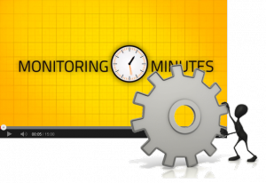

Der Ausfall eines Monitoring-Servers ist an sich ist nicht produktionskritisch. Trotzdem stellt er eine Gefahr dar. Ohne Monitoring befindet sich der Betrieb im Blindflug. Fehler, die Geld kosten oder Kunden verärgern bleiben unentdeckt. Matthias Gallinger hat sich Gedanken gemacht, wie man einen möglichst unterbrechungsfreien Monitoringbetrieb sicherstellt. Dabei achtete er darauf, dieses Ziel mit simpelsten Mitteln zu erreichen. Mit der vorgestellten Lösung bleibt Admins das Erlernen und Bedienen von komplexen Cluster-Frameworks erspart.
<!--more-->
&nbsp;
  
&#160;
  
&#160;
  

  

 
<a href="https://www.youtube.com/watch?v=fclw2r9dOwQ">Watch the video on YouTube</a>
