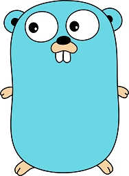

At this year's [FOSDEM] conference I did a 20 minutes presentation on how to implement `tail -f` in [Go]. The video is available on the FOSDEM website linked below.

_Abstract:_ As part of a log file monitoring tool, I implemented a file tailer that keeps reading new lines from log files. This turned out to be much more challenging than I thought, especially because it should run on multiple operating systems and it should be robust against logrotate. In this 20 Minutes talk I will present the lessons learned, the pitfalls and dead-ends I ran into.

<!--more-->

[Watch the video on the FOSDEM website](https://fosdem.org/2017/schedule/event/go_tail/)

* The FOSDEM talk: [https://fosdem.org/2017/schedule/event/go_tail/]
* The monitoring tool: [https://github.com/fstab/grok_exporter]
* Slides: [https://goo.gl/9ABX2R] (docs.google.com)

[FOSDEM]: https://fosdem.org
[Go]: https://golang.org/
[https://fosdem.org/2017/schedule/event/go_tail/]: https://fosdem.org/2017/schedule/event/go_tail/
[https://github.com/fstab/grok_exporter]: https://github.com/fstab/grok_exporter
[https://goo.gl/9ABX2R]: https://goo.gl/9ABX2R