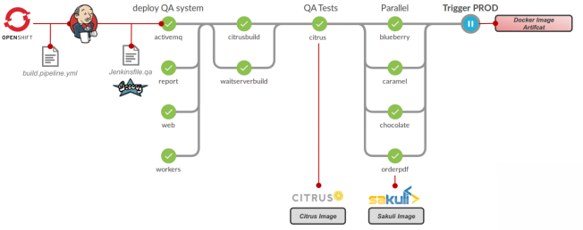

The GitHub repository [toschneck/openshift-example-bakery-ci-pipeline](https://github.com/toschneck/openshift-example-bakery-ci-pipeline) contains, the sourcecode for the examples of the talk **[Continuous Testing: Integration- und UI-Testing mit OpenShift-Build-Pipelines](https://www.slideshare.net/TobiasSchneck/continuous-testing-integration-und-uitesting-mit-openshiftbuildpipelines)** at the Redhat/ConSol OpenShift-Day:

<!--more-->

The example shows, how we can setup up total automated build pipeline with following components:

* [OpenShift Build Pipelines](https://docs.openshift.com/container-platform/3.5/install_config/configuring_pipeline_execution.html) 
* [Jenkinsfile](https://jenkins.io/doc/book/pipeline/jenkinsfile/)
* [Docker](https://www.docker.com/)
* [Maven](http://maven.apache.org/)
* [Citrus](https://github.com/christophd/citrus)
* [Sakuli](https://github.com/ConSol/sakuli)

For the complete sourcecode and description please visit:

#### **[toschneck/openshift-example-bakery-ci-pipeline](https://github.com/toschneck/openshift-example-bakery-ci-pipeline/blob/master/README.md)** 

#### Slides:

 <strong> <a href="https://www.slideshare.net/TobiasSchneck/continuous-testing-integration-und-uitesting-mit-openshiftbuildpipelines" title="Continuous Testing: Integration- und UI-Testing mit OpenShift-Build-Pipelines" target="_blank">Continuous Testing: Integration- und UI-Testing mit OpenShift-Build-Pipelines</a> </strong> from <strong><a target="_blank" href="https://www.slideshare.net/TobiasSchneck">Tobias Schneck</a></strong> 

[newest posts on ConSol Labs]: https://labs.consol.de