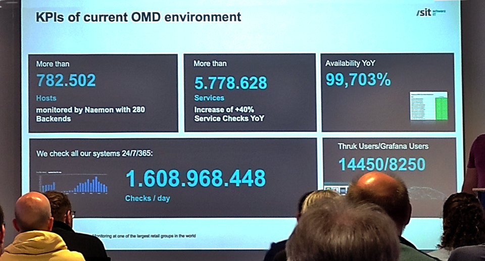

The `OMD Labs-Edition` is a monitoring platform that provides a new way to install, maintain and update a Nagios compatible monitoring system (when we talk about Nagios, we mean Nagios-like systems; our preferred core is Naemon). It contains most monitoring components from [omd.consol.de](/) and other useful add-ons from contributing authors. It is _not_ another Linux distribution; instead, it integrates into your current system as a single RPM or DEB package.

Have a look at the [getting started](getting_started) page for your first steps.

OMD Labs contains a wide range of [packages](packages) from the Nagios and Prometheus ecosystems.

## The Idea

The main idea is to make the initial installation easy and less time consuming while providing a stable and standardized platform for further activities. A Nagios system without add-ons and plugins is mostly useless, so OMD provides a way of making the initial setup fast and painless.

OMD-Labs goes a bit further and adds even more useful software. See the [differences page](differences) for a full list.

## The real life

## The Site Concept

OMD comes with a site concept that makes it possible to create and run multiple instances of OMD on one server. Sites can be renamed, copied and managed independently.

## Roadmap

There is usually one stable release every 6 months. Every day there are nightly builds with the [latest changes](https://github.com/ConSol-Monitoring/omd/blob/labs/Changelog).

  <a class="btn btn-success" href="#download" role="button" style="width:50%;">Stable: 5.70</a>
  <a class="btn btn-info" href="https://labs.consol.de/omd/builds.html" role="button" style="width:25%;">Nightly</a>
  <a class="btn btn-warning" href="https://github.com/ConSol-Monitoring/omd/blob/labs/Changelog" role="button" target="_blank" style="width:25%;">Next: Dec 2026</a>

 

Since OMD itself is rather complete, upcoming releases mostly update the shipped
components. There are no planned changes for OMD itself.

## Download

Best practice is to use the prebuilt packages from our repository as described in the [installation section](#installation).

The nightly builds are available via our [testing repository](/repo/testing/).

## Installation

The installation is quite easy when using our [Labs Repository](/repo/stable/). Just follow the steps for your operating system. After that, use
your package manager, such as _apt_, _yum_ or _zypper_, to search for and install OMD.

There are pre-built packages available for the following systems:

|| System | Version || Package |
|:--:|:-------|:-----------------:|:---------------|:---|
|      | RHEL/Centos       | 7      |                | [download](/repo/stable/#rhel--centos-7) |
|      | RHEL/Centos/Rocky | 8      |                | [download](/repo/stable/#rhel--rocky--alma-8) |
|      | RHEL/Centos/Rocky | 9      |                | [download](/repo/stable/#rhel--rocky--alma-9) |
|  | Debian            | 12     | Bookworm       | [download](/repo/stable/#debian-bookworm-120) |
|  | Debian            | 13     | Trixie         | [download](/repo/stable/#debian-trixie-130)  |
|      | SLES              | 15 SP4 |                | [download](/repo/stable/#sles-15-sp4) |
|      | SLES              | 15 SP5 |                | [download](/repo/stable/#sles-15-sp5) |
|      | SLES              | 15 SP6 |                | [download](/repo/stable/#sles-15-sp6) |
|  | Ubuntu            | 20.04  | Focal Fossa    | [download](/repo/stable/#ubuntu-focal-fossa-2004) |
|  | Ubuntu            | 22.04  | Jammy Jellyfish| [download](/repo/stable/#ubuntu-jammy-jellyfish-2204) |
|  | Ubuntu            | 24.04  | Noble Numbat   | [download](/repo/stable/#ubuntu-noble-numbat-2404) |

Rocky/CentOS/Red Hat will require the EPEL repository. Red Hat will additionally require these extra channels: <code>subscription-manager repos --enable=rhel-7-server-rpms \ --enable=rhel-7-server-extras-rpms \ --enable=rhel-7-server-optional-rpms</code>

## Filesystem Layout

OMD uses a standard Linux filesystem layout for etc, lib, var and other directories, with everything relative to the site's home folder.
Read more in the [filesystem layout documentation](filesystem_layout).

## OMD Commands

OMD offers a few commands to create and operate your sites.
See an overview in the [omd command reference](commands).

## Grafana Graphing

In addition to PNP4Nagios, the OMD Labs edition offers Grafana graphs. Read more on
that topic on the [graphing page](howtos/grafana/).

## E-Mail Notifications

OMD includes an easily customizable email notification script based on templates.
Read more about that in the [omd notification reference](howtos/html_notifications/).
