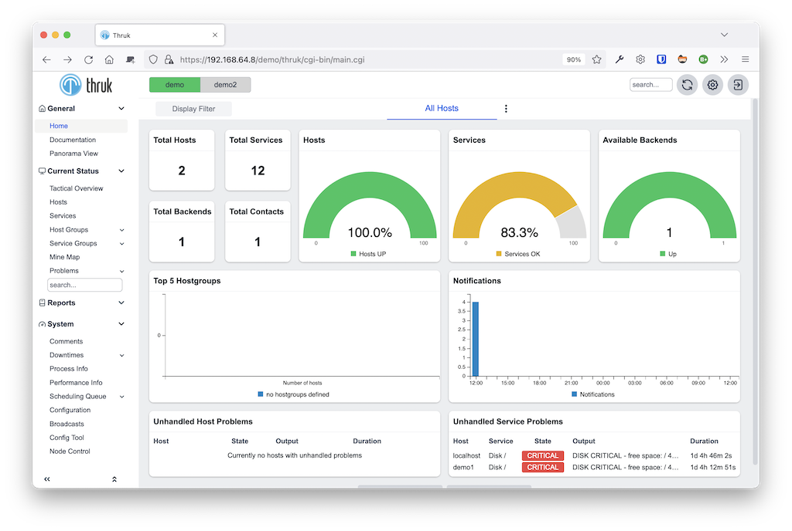
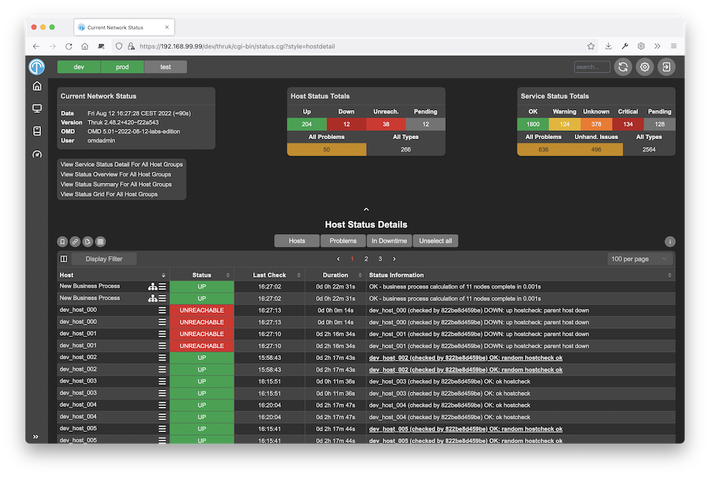

  

**[Thruk](https://www.thruk.org)** is a monitoring web interface that supports multiple backends, including Naemon, Nagios, Icinga and Shinken, through the Livestatus API.

It is designed to be a drop-in replacement and covers almost 100% of the original features, with additional enhancements for large installations and improved usability.

Sven Nierlein's OSMC 2022 talk on the redesign can be found on [YouTube](https://www.youtube.com/watch?v=ikMp5M3kt3k).

## Features

- Multiple backends
- Fast and efficient
- Clusterable
- Modern design
- Dashboards
- Powerful REST API
- Advanced filtering
- Dark mode and other themes
- Mobile friendly
- SLA Reporting + XLS Exports
- Recurring Downtimes
- Business Process Add-on
- ...

You can find more details [here](https://www.thruk.org/documentation/introduction.html#_reasons-to-choose-thruk).

## Documentation

A full knowledge base for users and developers can be found [here](https://www.thruk.org/documentation/).

## Download

Thruk is included in [OMD](docs/omd/) but you can find all packages [here](https://www.thruk.org/download.html).

## Changelog

The changelog is available on [GitHub](https://github.com/sni/thruk/blob/master/Changes)

## Screenshots

## Support

Professional support and consulting are available from [ConSol](https://www.consol.de/monitoring).
