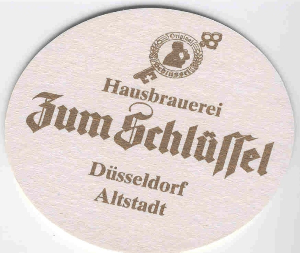
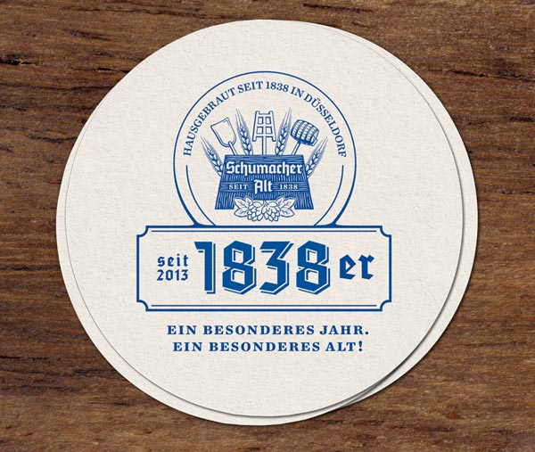

## Bis zum nächsten Mal

| **OK**|***MONITORS2017: Stimmung gut, Essen gut, Altbier gut. Der Workshop war gut besucht, die Leute haben sich rege ausgetauscht und sich mit "bis nächstes Jahr!" verabschiedet. Im Raum stehen Braunschweig und evt. wieder die Düsseldorfer Gegend.|   ***|
|---|---|---|

[https://twitter.com/search?q=%23monitors2017](https://twitter.com/search?q=%23monitors2017)

## Veranstaltungsdaten

Unter dem Motto **Monitors2017** fand der Workshop 2017 in Düsseldorf vom

  * **12.09. bis 13.09.2017**

statt und zwar in der Düsseldorfer Niederlassung der ConSol Consulting & Solutions Software GmbH. Die Adresse lautet:

  * **[Kanzlerstraße 8, D-40472 Düsseldorf](https://www.google.de/maps/place/Kanzlerstra%C3%9Fe+8,+40472+D%C3%BCsseldorf/@51.2623733,6.819636,17z/data=!4m5!3m4!1s0x47b8c90f0c6b6bcf:0x2912ebce131d6b7!8m2!3d51.26237!4d6.82183)**

## Ablauf

|Montag, 11.09.2017||
|---|---|
|19:00|[Vorabendtreff](vorabendtreff) in der [Hausbrauerei "Zum Schlüssel"](https://www.google.de/maps/place/Bolkerstra%C3%9Fe+41,+40213+D%C3%BCsseldorf/@51.2260621,6.7722811,17z/data=!3m1!4b1!4m5!3m4!1s0x47b8ca18487a2ba1:0x5061ee4f865e2eec!8m2!3d51.2260588!4d6.7744751) zur Einstimmung|
|Dienstag, 12.09.2017||
|09:00 - 09:45|CheckIn Workshop2017 - [ConSol, Kanzlerstraße 8, D-40472 Düsseldorf](https://www.google.de/maps/place/Kanzlerstra%C3%9Fe+8,+40472+D%C3%BCsseldorf/@51.2623733,6.819636,17z/data=!4m5!3m4!1s0x47b8c90f0c6b6bcf:0x2912ebce131d6b7!8m2!3d51.26237!4d6.82183)|
|09:45 - 10:00|Begrüßung|
|10:00 - 10:45|**Was ist Prometheus?** (Fabian Stäber)|
|10:45 - 11:00|Kaffeepause|
|11:00 - 11:45|[Iapetos: ein Naemon-Exporter für Prometheus (Philip Griesbacher)](vortraege#iapetosein_naemon-exporter_fuer_prometheus)|
|11:45 - 12:30|**Prometheus überwacht Kubernetes** (Fabian Stäber)|
|12:30 - 13:30|Mittagspause|
|13:30 - 14:15|**End-to-End mit Sakuli: Durchmarsch**  (Simon Meggle)|
|14:15 - 15:00|**SNMP-Traps ohne Datenbank** (Gerhard Laußer)|
|15:00 - 15:30|Kaffeepause|
|15:30 - 16:15|[Neues bei Thruk (Sven Nierlein)](vortraege#Neues_bei_Thruk)|
|16:15|Ende offizieller Teil - Veranstaltungspause|
|19:00|[Abendveranstaltung](abendveranstaltung) in der [Brauerei Schumacher](http://www.schumacher-alt.de/)|
|Mittwoch, 13.09.2017||
|09:00 - 09:45|[Storage-Monitoring per API statt SNMP (Björn Müller, Marcel Denia)](vortraege#storage_monitoring_per_api_statt_snmp_python_vs_perl)|
|09:45 - 10:15|Kaffeepause|
|10:15 - 11:00|**[ Sakuli Skalierungsmöglichkeiten](vortraege#sakuliskalierungsmoeglichkeiten)** (Simon Meggle)|
|11:00 - 11:45|**Check_MK** (Marcel Schulte)|
|11:45 - 12:30|[Verteiltes Monitoring mit OMD (Matthias Gallinger)](vortraege#Verteiltes_Monitoring_mit_OMD-Labs_-_Design_patterns)|
|12:30 - 13:30|Mittagspause|
|13:30 - 14:15|**Überwachen der IT Landschaft einer Uniklinik** (Paul Dvoran)|
|14:15 - 15:00|**Wie SuSE seine Infrastruktur monitort** (Lars Vogdt)|
|15:15 - 16:00|Jammern auf hohem Niveau|
|16:00|offizielles Ende bzw. "open end"|

## Vorträge

Ursprünglich war der Workshop als Nagios-Event initiiert - wir werden dieses Jahr u.a. über den Tellerrand blicken und uns auch über Newcomer wie Prometheus informieren beziehungsweise Möglichkeiten ausloten, wie man die beiden Welten optimal kombiniert.

## Was ist Prometheus?

//(Fabian Stäber)//

Wo sich Container-basierte Microservices verbreiten, kommen klassische Monitoring-Tools wie Nagios und Icinga an ihre Grenzen. Sie sind einfach nicht dafür ausgelegt, kurzlebige Objekte wie Container zu überwachen. In Cloud-Native-Umgebungen mausert sich daher Prometheus mit seinem auf Zeitreihen-Daten beruhenden Ansatz zu einem unverzichtbaren Werkzeug.

[Notizen](https://gist.github.com/fstab/3b4dc2b253174773a80bd86634da7523)
## Prometheus überwacht Kubernetes

//(Fabian Stäber)//

Kubernetes ist eine Plattform, mit der Docker-Container aufgesetzt, skaliert und über Rechnergrenzen hinweg verteilt werden. Viele microsoervice-basierte Anwendungen werden auf diese Weise betrieben. Zur Überwachung so einer dynamischen Umgebung bietet sich wiederum Prometheus an. Dennoch gibt es in einem Kubernetes-Cluster noch jede Menge klassischer IT-Komponenten, welche sich leicht mit Nagios monitoren lassen. Beide Tools zusammen findet man in der Open Monitoring Distribution, die somit der ideale Partner für Kubernetes ist.

[Notizen](https://gist.github.com/fstab/eab5df0c249c9645875966d252c27572)
## SNMP-Traps ohne Datenbank

//(Gerhard Laußer)//

In neueren OMD-Versionen ist es möglich, SNMP-Traps am mehrere Sites (Test, Prod, etc.) weiterzuleiten. Dort landen sie dann in einem Logfile. Es wird gezeigt, wie man dieses überwacht, um bestimmte Traps weiterzumelden. Weiterhin wird vorgestellt, wie man mit coshsh und vorgefertigten Mib-Dateien vollautomatisch passive Trap-Services für Netzwerkgeräte generiert.

Folien: [ws2017-traps-mit-coshsh.pdf](../ws2017-traps-mit-coshsh.pdf)
## Iapetos: ein Naemon-Exporter für Prometheus

//(Philip Griesbacher)//

Mit Hilfe des in Go geschriebenen NEB-Moduls ist es möglich, sämtliche Checkergebnisse und Metriken, die ein Naemon oder Nagios4 sammelt, im Prometheus-Format zu exportieren. Auf diese Weise kann man die vorhandene Monitoringlandschaft ohne Aufwand in eine zeitreihenbasierte Überwachung integrieren.

Folien: [https://www.slideshare.net/PhilipGriesbacher/monitoring-workshop-2017-philip-griesbacher-iapetos](https://www.slideshare.net/PhilipGriesbacher/monitoring-workshop-2017-philip-griesbacher-iapetos)

## Storage Monitoring per API statt SNMP, Python vs. Perl

//(Björn Müller, Marcel Denia)//

Zur Abfrage von Geräteinformationen im Netzwerk wird traditionell das Simple Network Management Protocol eingesetzt. Bei den Storage Herstellern ist immer häufiger zu beobachten, dass nur per RESTful HTTP API alle fürs Monitoring relevanten Informationen zur Verfügung gestellt werden. In diesem Vortrag beleuchten wir die Abfragen eines Huawei OceanStore per API. Hierbei vergleichen sich die Programmiersprachen Python und Perl. Möge der bessere gewinnen!

Folien: [pythonperlbattle.pdf](../pythonperlbattle.pdf)
## End-to-End mit Sakuli: Durchmarsch

//(Simon Meggle)//

Mit dem Open-Source-Tool [Sakuli](http://www.sakuli.org) können beliebige Benutzeroberflächen (Web und Rich-Clients) automatisiert getestet werden. Die integrierten Forwarder-Module reichen die Ergebnisse solcher Roboter-Tests an Monitoring-Systeme wie Nagios/Naemon, Icinga1/2 und seit kurzem auch an check_mk weiter. In diesem Vortrag geht es wörtlich "vom Ende bis zum Ende": ich zeige, wie Sakuli auf einem blanken Windows installiert wird, erstelle einen realen Testcase, binde OMD zum Empfang der Ergbnisse an und zeige zu guter Letzt, welche Grafana-Graphen sich aus den Performancedaten holen lassen. Zugunsten eines möglichst umfassenden Überblicks werde ich bewusst das ein oder andere technische Detail zu Sakuli verzichten.

## Sakuli: Skalierungsmöglichkeiten

//(Simon Meggle)//

Eine Handvoll Sakuli-Testclients sind schnell manuell aufgesetzt, einzelne Tests noch manuell verwaltbar. Ab einer bestimmten Installationsgröße jedoch kommt man um Automatisierung nicht mehr herum, damit das E2E-Monitoring weiter skalieren kann. Ich zeige hierfür verschiedene Lösungsansätze bzw. -konzepte.

[Folien (Slideshare)](https://www.slideshare.net/simmerl121/sakuli-skalierungsmglichkeiten-windows-openshift-kubernetes)
## Verteiltes Monitoring mit OMD-Labs - Design patterns

//(Matthias Gallinger)//

Beim Monitoring großer bzw. global verteilter IT-Infrastrukturen sind viele Aspekte zu berücksichtigen: Automatisierung der Konfiguration, Ausfallsicherheit, Visualisierung der Performancedaten und Leitungsengpässe zu entlegenen Standorten um nur einige zu nennen. In diesem Vortrag möchte ich aufzeigen, wie man solche Herausforderungen mit OMD-Labs und den darin enthaltenen Tools meistert, "wenn es ein oder zwei Schuhnummern größer sein darf". Ein Vortrag quasi aus dem Nähkästchen!

Folien: [distribute-monitoring-workshop2017.pdf](../distribute-monitoring-workshop2017.pdf)

## Neues bei Thruk

//(Sven Nierlein)//

Der obligatorische Thruk Vortrag mit Neuigkeiten aus einem Jahr Entwicklung. Neben den visuellen Erweiterungen in Form eines neuen Standard Themes hat sich auch unter der Haube viel getan. Eine einfachere Pluginverwaltung mit Online Repository, das Broadcast System, LMD und vieles mehr. Der Vortrag stellt den aktuellen Stand der Entwicklung vor.

Folien: [thruk-2017.pdf](../thruk-2017.pdf) [grafana-pnp.pdf](../grafana-pnp.pdf)
## Überwachen der IT Landschaft einer Uniklinik

//(Paul Dvoran)//

Ein kurzer Überblick der IT einer Uniklinik (uk-koeln.de) und der Versuch diese sinnvoll zu überwachen.

Folien: [monitoring_workshop_2017_praesentation_ukkoeln.pdf](../monitoring_workshop_2017_praesentation_ukkoeln.pdf)

### Workshops

## coshsh-Aha-Effekt

//(Gerhard Laußer)//

Du bringst eine Datenbank o.ä. mit und wir flanschen eine minimale coshsh-Datasource dran, mit der du dann weiterarbeiten kannst.

## Sakuli

//(Simon Meggle)//

Du hast bereits mit Sakuli gearbeitet, hängst aber an einem konkreten Problem und kommst nicht weiter? Wir können uns das zusammen ansehen.

## Jammern auf hohem Niveau

//(Teilnehmer)//

Es gab ja mal auf vergangenen Workshops die sog. Speakers Corner. Bei diesen spontanen Minivorträgen konnten Admins erzählen, wie ihre IT-Umgebung und das zugehörige Monitoring aussieht. Wir drehen den Spieß um und geben Admins die Gelegenheit, über weiße Flecken ihres Monitorings zu klagen, Wünsche zu äußern, wie denn ein ideales Monitoring aussehen könnte. Die anwesenden Entwickler werden möglicherweise bald nach dem Workshop mit entsprechender Software aufwarten können.

## OMD-Labs Edition: Hidden Features

//(...)//

Mit OMD-Labs werden einige nützliche "Helferlein" ausgeliefert, die wir in dem Workshop mal ans Tageslicht befördern und vorstellen wollen.

## Anmeldung

Mit Eingang der [Anmeldung](https://eveeno.com/monitors2017)  werden wir die Teilnehmerliste aktualisieren.
Mit dem Eintrag in der Liste ist somit die[Anmeldung](https://eveeno.com/monitors2017) bestätigt.

Wie in den vergangenen Jahren ist die Teilnahme am Workshop wieder kostenlos. Die Unterbringung und Anreise ist jedoch komplett von den Teilnehmern selbst zu organisieren und zu tragen. Für Verpflegung und Getränke tagsüber wird ein Unkostenbeitrag erhoben. Rechnet mit ca. 50€.

## Max. Teilnehmerzahl pro Unternehmung/Anwenderbereich

**WICHTIG!** Pro Unternehmung/Anwenderbereich sind dieses Jahr max. **3 Personen** zugelassen. Diese Regelung ermöglicht, dass mehr Personen aus unterschiedlichen Einrichtungen teilnehmen können.

## Anmeldeformlar

Die Anmeldung erfolgt über eine externe Ticketing-Seite
<html>
<a class='eveenoButton orange' href='https://eveeno.com/215126078' target='_blank'>Anmelden über eveeno »</a>
</html>

Mit Eintrag der Daten in der Teilnehmerliste gilt die Anmeldung als bestätigt. Dieses Jahr ist die Teilnahme auf **75 Personen** begrenzt.

## Anreise / Hotel

Anreise und Unterbringung ist von jedem Teilnehmer selbst zu organisieren.

## Hotelempfehlungen

  * [B&B Hotel Düsseldorf-Airport](https://www.hotelbb.de/de/destination/duesseldorf)
  * [Avidon Art & Design Hotel](http://www.avidon.de)
  * [Hotel Am Vogelsanger Weg](http://www.hotel-vogelsanger-weg.de)
  * [Mercure Hotel Düsseldorf City Nord](https://www.accorhotels.com/de/hotel-5371-mercure-hotel-duesseldorf-city-nord/index.shtml)
  * [Renaissance Duesseldorf Hotel](http://www.marriott.com/hotels/travel/dusrn-renaissance-duesseldorf-hotel/)

## Vorabendtreff

 

//"Wir empfehlen Ihnen ein Original Schlüssel-Alt, das unsere Braumeister nach alter Tradition per Hand herstellen. Das naturbelassene, obergärige Brauverfahren gibt unserem Schlüssel seinen milden, vollmundigen Geschmack. Das haben auch Experten erkannt: 2012 und 2014 erhielt Original Schlüssel beim European Beer Star Award als bestes Altbier International die Goldmedaille."//

Na, wie klingt das? Alle, die am Montag schon in Düsseldorf sind und die anderen Teilnehmer beschnuppern oder wiedersehen wollen, treffen sich **ab 19 Uhr** in der [Hausbrauerei Zum Schlüssel](https://www.zumschluessel.de/), [Bolkerstr. 41-47](https://www.google.de/maps/place/Bolkerstra%C3%9Fe+41,+40213+D%C3%BCsseldorf/@51.2260621,6.7722811,17z/data=!3m1!4b1!4m5!3m4!1s0x47b8ca18487a2ba1:0x5061ee4f865e2eec!8m2!3d51.2260588!4d6.7744751), wo für uns ein paar Tische reserviert sind.

Nachtrag (gl): Diese o.g. Goldemedaille wurde völlig zu Recht verliehen!

## Abendveranstaltung

 

Nach dem ersten Workshoptag (Dienstag) gibt's deftiges Abendessen in der [Brauerei Schumacher](http://www.schumacher-alt.de/) in der [Oststraße 123, 40210 Düsseldorf](https://www.google.de/maps/place/Oststra%C3%9Fe+123,+40210+D%C3%BCsseldorf/@51.2216297,6.7832535,17z/data=!3m1!4b1!4m5!3m4!1s0x47b8ca3b0729c409:0xe63288093f0a5d05!8m2!3d51.2216264!4d6.7854475). Eigenen Angaben nach gibt es dort das älteste Altbier Düsseldorfs.

Der Unkostenbeitrag von 25€ für das Essen (ohne Getränke) und die Saalmiete ist auf der Anmeldeseite extra ausgewiesen.

